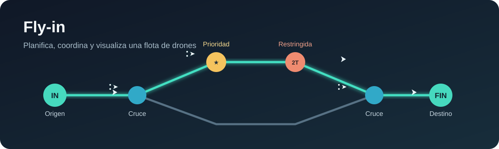
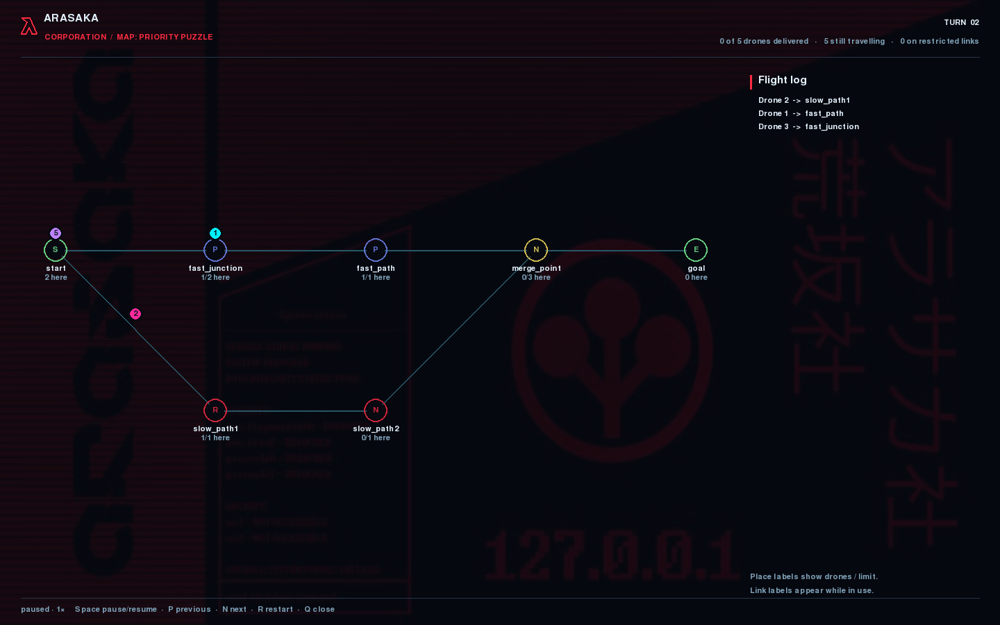
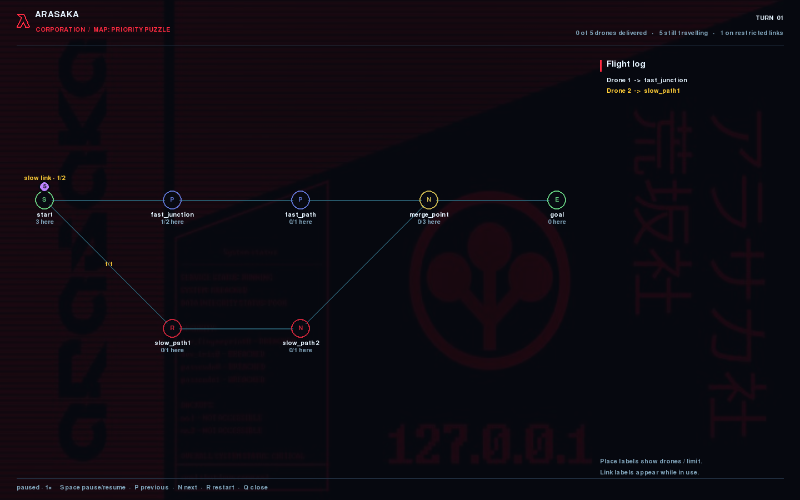
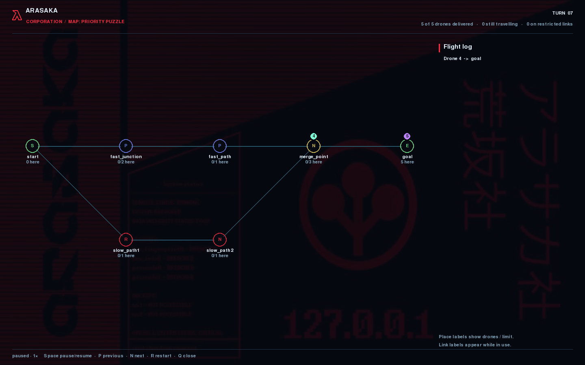
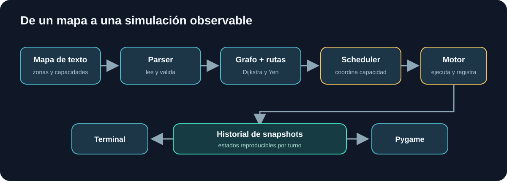

# Fly-in

**Simulación y planificación de rutas para flotas de drones en mapas con capacidad limitada.** Fly-in combina búsqueda de caminos, coordinación de movimientos y visualización para explorar cómo una flota atraviesa una red con cuellos de botella, zonas especiales y rutas alternativas.

> Proyecto realizado por **Kevin Castro** como parte del currículo de 42.



## Qué aporta

- **Planificación de rutas:** Dijkstra calcula rutas de coste mínimo y Yen obtiene rutas simples alternativas. El coste contempla el tránsito de dos turnos por zonas restringidas y favorece zonas prioritarias cuando las rutas empatan.
- **Coordinación bajo restricciones:** el planificador organiza los movimientos por turno respetando la capacidad de las conexiones, la ocupación de las zonas y las llegadas reservadas.
- **Simulación reproducible:** el motor valida cada conjunto de movimientos, gestiona drones en tránsito y conserva snapshots inmutables para revisar la evolución.
- **Mapas extensibles:** un formato de texto sencillo permite declarar zonas, conexiones, capacidades, tipos y colores.
- **Dos formas de observar la ejecución:** una animación con Pygame y un panel interactivo en terminal hacen visibles rutas, congestión, capacidades y eventos.

## Capturas de la simulación

Estas imágenes salen de fotogramas reales del motor al ejecutar `03_priority_puzzle.txt`: muestran la flota en movimiento, un dron cruzando una zona restringida y la llegada. La interfaz usa una paleta de neón y el entorno visual de Arasaka, inspirado en *Cyberpunk 2077*, uno de mis juegos favoritos.







Para volver a generar las capturas desde el historial del motor:

```sh
.venv/bin/python scripts/capture_screenshots.py
```

## Arquitectura

El diseño separa el formato del mapa, el dominio de la planificación y la presentación. El motor ejecuta las decisiones del scheduler y registra estados que consumen ambas visualizaciones.



## Requisitos

- Python 3.10 o posterior
- `make` para los comandos de conveniencia
- Pygame CE para la ventana gráfica (se instala con el proyecto)

## Inicio rápido

```sh
make
make run MAP=maps/easy/02_simple_fork.txt
```

`make` crea `.venv` si hace falta e instala el proyecto. `make run` imprime los movimientos por turno y abre el visualizador gráfico. Para ejecutar sin `make`:

```sh
.venv/bin/python main.py maps/easy/01_linear_path.txt
.venv/bin/python main.py --visualize maps/medium/02_circular_loop.txt
.venv/bin/python main.py --terminal-visualize maps/easy/02_simple_fork.txt
```

También se puede elegir el mapa con `--map` o `--maps`. La lista de mapas y sus desafíos está en [`maps/README.md`](maps/README.md).

### Controles visuales

En Pygame: `Espacio` pausa o reanuda, `N` y `P` avanzan o retroceden un turno, `+` y `-` cambian la velocidad, `R` reinicia y `Q` o `Esc` cierra.

En el panel de terminal: `Espacio` pausa o reanuda, `N` avanza mientras está pausado, `+` y `-` cambian la velocidad y `Q` sale. En ejecución no interactiva, el panel avanza automáticamente.

## Formato de mapa

Los mapas son archivos de texto UTF-8. Se declara primero el número de drones, después las zonas y al final las conexiones. Se ignoran líneas vacías y comentarios iniciados por `#`.

```text
nb_drones: 2
start_hub: start 0 0 [color=green]
hub: junction 1 0 [zone=priority max_drones=2 color=cyan]
hub: slow 2 0 [zone=restricted]
end_hub: goal 3 0 [color=red]
connection: start-junction [max_link_capacity=2]
connection: junction-slow
connection: slow-goal
```

Las zonas admiten `zone` (`normal`, `priority`, `restricted` o `blocked`), `max_drones` y `color`. Las conexiones admiten `max_link_capacity`. Si no se especifican, el tipo de zona es `normal` y las capacidades son de una unidad. Los nombres de zona no pueden contener guiones, ya que las conexiones usan `zona_a-zona_b`.

## Cómo funciona

1. **Lectura y validación:** `MapParser` convierte el archivo en datos del dominio y comprueba declaraciones y referencias.
2. **Construcción de rutas:** el grafo de adyacencia asigna costes de movimiento; Dijkstra busca la ruta de menor coste y Yen genera una alternativa simple. Las rutas se reparten cíclicamente entre los drones.
3. **Planificación por turno:** el scheduler decide qué drones pueden avanzar atendiendo a capacidades y ocupación.
4. **Ejecución y observación:** el motor aplica los movimientos validados, actualiza los tránsitos y guarda snapshots. Los visualizadores reproducen ese historial.

Entrar en una zona restringida inicia un tránsito de dos turnos. Las zonas bloqueadas no son destinos válidos. En la salida estándar, cada línea representa un turno: `D<ID>-<zona>` indica movimiento o llegada, y `D<ID>-<zona_a>-<zona_b>` indica que el dron inicia un tránsito restringido. Los drones que esperan no aparecen en esa línea.

## Estructura del proyecto

| Ruta | Responsabilidad |
| --- | --- |
| `src/domain/` | Modelos del mapa y grafo de adyacencia |
| `src/parser/` | Lectura y validación de mapas |
| `src/algorithms/` | Dijkstra y rutas alternativas con Yen |
| `src/simulation/` | Estado de drones, scheduler, motor e historial |
| `src/display/` | Visualizadores de terminal y Pygame |
| `maps/` | Mapas de ejemplo, organizados por dificultad |
| `scripts/` | Experimento de comparación de políticas de rutas |

## Ejemplo de salida

Para un mapa lineal con un dron, la ejecución puede producir:

```text
D1-middle
D1-goal
```

Si Pygame no puede abrir una pantalla gráfica, se informa del error y la salida estándar de la simulación sigue disponible. Los errores de mapa o simulación se envían a la salida de error y devuelven un código distinto de cero.

## Ideas y decisiones de implementación

- Modelar el mapa como un grafo permite tratar de forma uniforme rutas simples, ciclos y conexiones con coste de movimiento.
- Separar el scheduler del motor concentra las restricciones de planificación y mantiene la ejecución responsable de validar y aplicar decisiones.
- Registrar snapshots en el motor permite que las interfaces inspeccionen la simulación sin planificar ni modificar movimientos.
- Comparar políticas de rutas se mantiene como experimento independiente en `scripts/compare_routing_policies.py`, fuera del flujo normal de ejecución.

## Créditos y referencias

- E. W. Dijkstra, [“A note on two problems in connexion with graphs”](https://doi.org/10.1007/BF01386390), *Numerische Mathematik*, 1959.
- J. Y. Yen, [“Finding the K Shortest Loopless Paths in a Network”](https://doi.org/10.1287/mnsc.17.11.712), *Management Science*, 1971.
- [Documentación de Python](https://docs.python.org/3/) · [Documentación de pygame-ce](https://pyga.me/docs/)

---

*La documentación describe las implementaciones presentes en el código del proyecto.*
